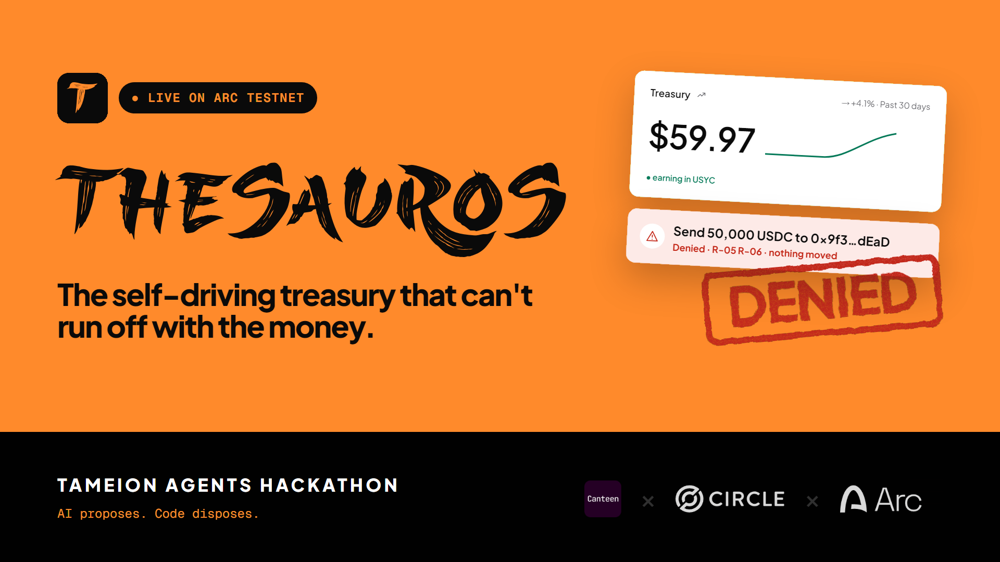
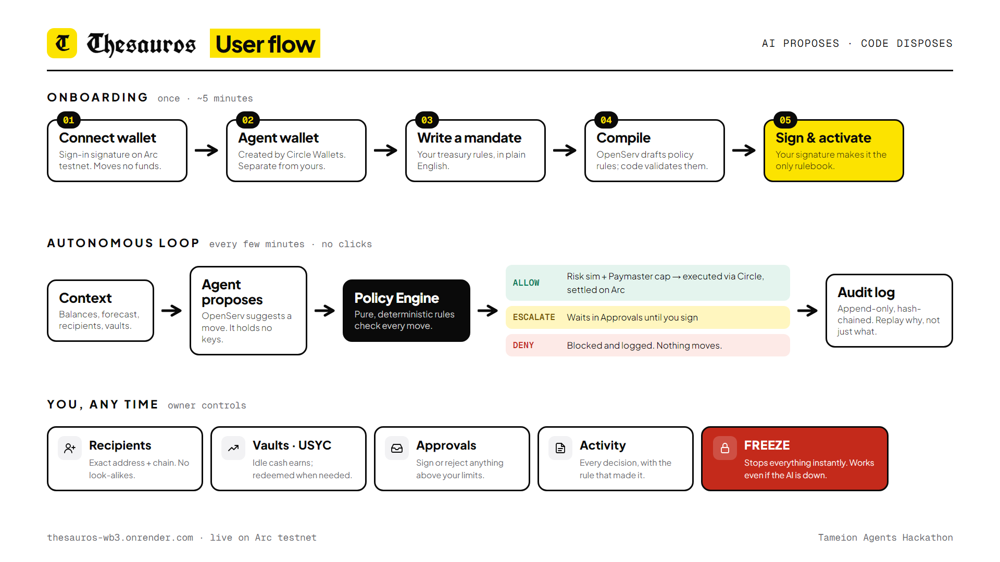
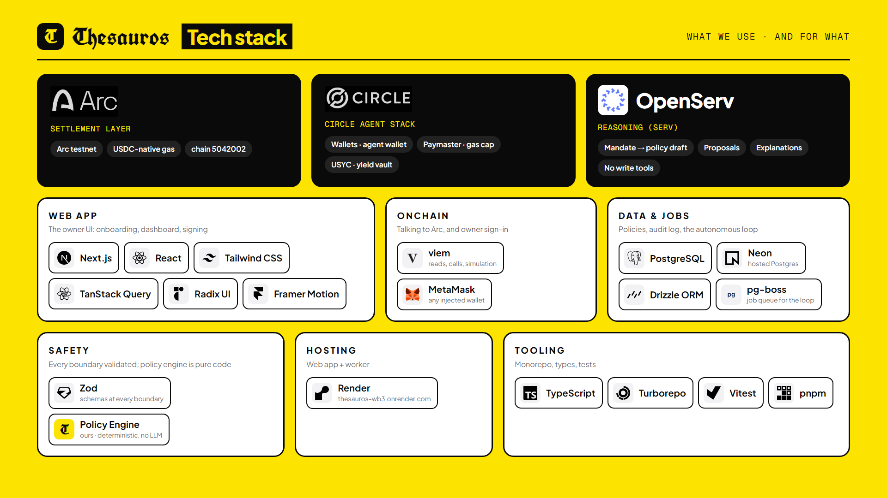

<div align="center">



# Thesauros

**The treasury that reconciles itself before it pays.**

An autonomous, AI-operated business treasury settled in USDC on Arc.<br />
The AI proposes. Deterministic code disposes.

[**Live app**](https://thesauros-wb3.onrender.com) · [**Demo video**](https://youtu.be/ZgaEqr7Y4e0) · [**Verifiable proofs**](docs/PROOFS.md) · [How it works](#how-it-works) · [Safety model](#safety-model) · [Quick start](#quick-start) · [Docs](#documentation)

[](https://docs.arc.network)
[](https://www.circle.com/usdc)
[](docs/PROOFS.md)
[](tsconfig.base.json)
[](https://thecanteenapp.com)

</div>

---

## At a glance

| | |
|---|---|
| **Pilot** | A five-person team ran its monthly hosting bill and member payouts through Thesauros. The agent made **6 payments (500 USDC)** on its own, every one confirmed on-chain. |
| **On-chain** | **8 successful agent transactions** on Arc testnet: 6 recipient payments and 2 deposits into Circle's USYC Teller. |
| **Usage** | **12** wallets connected · **57** mandates written · **26** policy versions signed · **24** agent decisions (21 `ALLOW`, 2 `DENY`) |
| **Audit** | **14,000+** append-only, hash-chained audit-log entries |

Every figure links to a public transaction or a re-runnable query in [**docs/PROOFS.md**](docs/PROOFS.md).

## Demo

<a href="https://youtu.be/ZgaEqr7Y4e0"></a>

**[▶ Watch the 3-minute product demo](https://youtu.be/ZgaEqr7Y4e0)** — onboarding, mandate to signed policy, recipients,
the USYC vault, the Policy Engine denying proposals, and Freeze.

## Why Thesauros

Small businesses, DAOs and solo founders hold USDC that sits idle while bills are paid by hand. An AI
agent could run that treasury, but handing a model the keys is a risk no owner should take: one prompt
injection, hallucinated amount or look-alike address, and the money is gone. A ledger only proves that
debits equal credits; it says nothing about whether the agent's reasoning was sound.

Thesauros separates **judgement** from **authority**:

1. The owner writes a **mandate** in plain English.
2. Thesauros compiles it into an explicit, numeric **policy** that the owner reviews and signs.
3. An autonomous loop keeps idle USDC productive in **USYC**, pays allowlisted recipients on schedule, and
   re-screens counterparties continuously.
4. Every proposal must pass a **pure Policy Engine** and a **simulation gate** before anything is sent.
   A model output can never move funds by itself.
5. The owner can **Freeze** and **sweep funds home** at any time, even if the model, the worker or the
   reasoning API is down.

Built for the **Tameion Agents Hackathon** (Canteen × Circle) — **RFB 1: Intelligent Business Treasury**,
with **RFB 5: Compliance Intelligence** as a secondary surface.

## How it works



| Stage | What happens |
|---|---|
| **Onboarding** · once, ~5 min | Connect a wallet (sign-in only; moves no funds) → a dedicated Circle agent wallet is created → write a mandate → OpenServ drafts the rules and code validates them → the owner's signature makes the policy the only rulebook. |
| **Autonomous loop** · continuous | Gather deterministic context → the agent proposes an action with an explanation → the Policy Engine returns `ALLOW`, `ESCALATE` or `DENY` → allowed actions are simulated against real chain state, then executed through Circle → every step is written to the audit log. |
| **Owner controls** · any time | Recipients (exact address + chain), Vaults, Approvals, Activity (every decision and the rule behind it), and **Freeze**. |

## Safety model

Verdict precedence is always **`DENY` > `ESCALATE` > `ALLOW`**. Anything unknown, stale or malformed fails closed.

| Guarantee | How it is enforced |
|---|---|
| **Reasoning never touches funds** | Only the executor may call a Circle write action, and only with a valid, unexpired, single-use allow-receipt from the Policy Engine. The model is never given a write tool. |
| **The Policy Engine is pure** | No network, no model, no clock, no randomness, no environment access — enforced at build time by `pnpm check:arch`. Every denial names the rule that caught it (e.g. `R05` non-allowlisted destination, `R06` per-transaction cap). |
| **Exact-match destinations** | Recipients and contracts match by checksummed address **and** chain id. No ENS at execution time, no fuzzy matching. |
| **Simulate before sending** | Each action is dry-run through Arc's `Multicall3From`; measured balance deltas must match the proposal or it is denied. |
| **The owner always wins** | Freeze, revoke and sweep-home never call the reasoning layer. |
| **Append-only audit** | Every snapshot, proposal, verdict, execution, approval and freeze is recorded; a database trigger blocks updates and deletes, and the hash chain is verifiable from Settings. |
| **Exact money math** | Token amounts are `bigint` base units; USD values are integer micro-USD. No floating point anywhere. |
| **Idempotent execution** | Each execution is keyed by its proposal hash; receipt nonces are single-use at the database level. |

Full threat model and failure matrix: [`docs/SECURITY.md`](docs/SECURITY.md).

## Circle and Arc integration

| Product | How Thesauros uses it |
|---|---|
| **Arc** | Settlement layer. USDC is the gas token and finality is sub-second, so each agent action costs about a cent. |
| **Circle Wallets** | Every treasury gets its own developer-controlled agent wallet, separate from the owner's wallet. All sends go through the receipt-gated executor. |
| **USYC** | Idle USDC is deposited into the USYC Teller and redeemed — in full or in part — when the cash-flow forecast needs it. Share price is read live from the USYC price API. |
| **Gas sponsorship (Paymaster)** | Gas is sponsored through Circle's console policy, adding an on-platform spend cap beneath the Policy Engine's own per-action limits. |
| **USDC** | The unit of account for balances, recipients, caps and payments. |

Contract addresses and every external fact we rely on are verified in [`docs/VERIFY.md`](docs/VERIFY.md).
**Planned, not claimed:** CCTP cross-chain payouts, Gateway and EURC.

## Tech stack



| Layer | Technology |
|---|---|
| Settlement | Arc testnet (chain id 5042002), USDC-native gas |
| Circle | Wallets (developer-controlled), USYC Teller, Gas Station sponsorship |
| Reasoning | OpenServ (SERV): mandate compilation, proposals and explanations — read-only, no write tools |
| Web | Next.js 15, React, Tailwind CSS, TanStack Query, Radix UI, Framer Motion |
| On-chain | viem for reads, calls and simulation; MetaMask or any injected wallet for owner signatures |
| Data & jobs | PostgreSQL (Neon), Drizzle ORM, pg-boss |
| Correctness | Zod at every boundary, Vitest, an adversarial prompt-injection corpus, dependency-cruiser boundaries |
| Tooling | TypeScript (strict), pnpm, Turborepo |
| Hosting | Render (web and worker) |

## Judging criteria

| Criterion | Where to look |
|---|---|
| **Agentic sophistication · 30%** | The agent decides *what* to do (deposit, redeem, pay, hold) and *why*; a deterministic engine verifies it. Mandate compilation, explained proposals, shadow mode, an anti-repeat guard and a replayable decision log. |
| **Traction · 30%** | A real team's recurring payments, 8 successful on-chain transactions and 12 connected wallets — all verifiable in [`docs/PROOFS.md`](docs/PROOFS.md). |
| **Circle tool usage · 20%** | Arc, Wallets, USYC and gas sponsorship, wired into production paths — see [Circle and Arc integration](#circle-and-arc-integration). |
| **Innovation · 20%** | "AI proposes, code disposes": a pure policy engine, receipt-gated execution, pre-send simulation and a hash-chained audit trail. |

## Quick start

**Use it:** open the [live app](https://thesauros-wb3.onrender.com), connect MetaMask on Arc testnet, and
write a mandate such as *"Keep $200 liquid, put the rest in USYC, pay Acme up to $50 a month."*

**Run it locally** (Node 22+, pnpm, Docker):

```bash
pnpm install
cp .env.example .env.local   # add CIRCLE_API_KEY, CIRCLE_ENTITY_SECRET, SERV_API_KEY,
                             # SESSION_SECRET and RECEIPT_HMAC_SECRET
docker compose up -d
pnpm db:migrate
pnpm dev                     # web on :3000, worker in the background
```

Circle credentials come from the [Circle Developer Console](https://console.circle.com); OpenServ
credentials from [openserv.ai](https://openserv.ai). Secrets live only in `.env.local`, which is git-ignored.

**See the Policy Engine say no:**

```bash
pnpm db:seed:demo                        # a real Circle testnet treasury, policy and recipients
pnpm demo:attack <walletId> <recipientId>
```

`demo:attack` fires an over-cap payment and a payment to a non-allowlisted address through the real
Policy Engine and prints each `DENY` with the rule that caught it.

**Verify the build:**

```bash
pnpm typecheck && pnpm lint && pnpm test && pnpm test:adversarial && pnpm check:arch && pnpm build
```

## Repository layout

```
apps/
  web/        Next.js owner UI and API routes
  worker/     autonomous decision loop and job handlers
packages/
  policy/     pure Policy Engine — rules, verdicts, allow-receipts
  reasoning/  OpenServ client, mandate compiler, prompt-injection defences
  wallet/     receipt-gated Circle executor, USYC reads, action registry
  risk/       simulation and risk gate
  context/    deterministic context gathering
  db/         Drizzle schema, migrations, append-only audit log
  shared/     schemas, env, money math, signing messages
contracts/    Solidity test contracts
scripts/      demo seed, attack script, proofs query, live end-to-end checks
docs/         specifications, verification log and proofs
```

## Documentation

| Document | Purpose |
|---|---|
| [`docs/PROOFS.md`](docs/PROOFS.md) | On-chain transactions and usage, all independently verifiable |
| [`docs/PRD.md`](docs/PRD.md) | Product requirements |
| [`docs/ARCHITECTURE.md`](docs/ARCHITECTURE.md) | System design and runtime flows |
| [`docs/SECURITY.md`](docs/SECURITY.md) | Threat model, custody model and failure matrix |
| [`docs/POLICY_ENGINE.md`](docs/POLICY_ENGINE.md) | Policy schema and rule catalogue |
| [`docs/REASONING.md`](docs/REASONING.md) | Reasoning tasks, validation and injection defence |
| [`docs/CIRCLE_INTEGRATION.md`](docs/CIRCLE_INTEGRATION.md) | Circle and Arc setup |
| [`docs/VERIFY.md`](docs/VERIFY.md) | External facts verified against live Arc and Circle |
| [`docs/TESTING.md`](docs/TESTING.md) | Test strategy and adversarial corpus |
| [`docs/PROGRESS.md`](docs/PROGRESS.md) | Status log and decision record |
| [`CLAUDE.md`](CLAUDE.md) | Engineering invariants and build workflow |

## Status and limits

- **Testnet only.** The code refuses Arc mainnet unless explicitly enabled after a human sign-off gate.
- **USYC is permissioned.** Teller access requires a Circle allowlist and Reg S eligibility, so most testers
  can exercise payments and policies but not the vault.
- **Gas sponsorship policies** are managed in the Circle console; Circle does not yet expose an API for them.

## Credits

Hosted by [Canteen](https://thecanteenapp.com), with [Circle](https://www.circle.com) as platform partner
and [Arc](https://docs.arc.network) as the settlement chain. Reasoning by [OpenServ](https://openserv.ai).
Wordmark font: Sukajan Brush by tkzgraphic, used with the author's permission.

Built by **Shane Joans V**.
